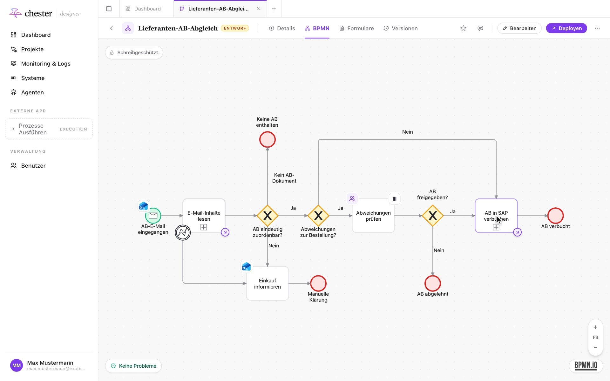

# chester Designer

**Die offene Entwicklungsumgebung für Geschäftsprozesse, KI-Mitarbeiter und Systeme in BPMN 2.0.**

> **Coming soon.** Der Quellcode wird in Kürze in diesem Repository veröffentlicht. Die Tabelle unten zeigt den geplanten Umfang.
> Wer vorab informiert werden möchte, klickt oben auf „Watch“ oder trägt sich in die
> [Warteliste](https://www.gochester.de/kontakt?anlass=allgemein&topic=open-source) ein.

## Worum es geht

Der chester Designer ist die Entwicklungsumgebung von chester, als Open Source.
Behörden und Unternehmen führen damit ihren Prozesskatalog, modellieren Abläufe
im offenen Standard BPMN 2.0 und dokumentieren sie an einer Stelle. Fachbereich,
IT und Revision lesen dasselbe Modell.

## Geplanter Umfang

### Kern

| Bereich | Inhalt |
| --- | --- |
| Prozesskatalog | Projekte, Prozessbereiche, Prozessgruppen und Prozesse in einer Struktur, dazu Kataloge und Favoriten |
| Modellierung | BPMN-2.0-Modeler auf Basis von bpmn.io, mit den Elementen von chester |
| Eigenschaften | je Element Name und Dokumentation |
| Dokumentation | Dokumentation zu jedem Prozess, mit Text und Bildern |
| Versionen | Jede gespeicherte Änderung als Version, wiederherstellbar |
| Zusammenarbeit | Kommentare und Benachrichtigungen |
| Benutzer | Benutzer, Gruppen und Rollen |
| KI-Anbindung | MCP-Server, über den ein KI-Assistent Prozesse und Elemente anlegt und die Struktur liest |

### In Prüfung

Diese Bereiche prüfen wir für eine spätere Version.

| Bereich | Inhalt |
| --- | --- |
| Formulare | Formulare für Aufgaben, per Drag and Drop |
| Entscheidungstabellen | Regeln und Schwellen als Tabelle, mit Trefferregeln |
| KI-Mitarbeiter | KI-Mitarbeiter mit Aufgaben, Wissen und Werkzeugen modellieren, also Adaptern und BPMN-Prozessen als Tools |
| Systemregister & Adapter-Katalog | EAM Lite mit allen Systemen, ihren Schnittstellen, ihrer Dokumentation und den Prozessen, die sie nutzen |
| Element-Konfiguration | je Element die Einstellungen für die Ausführung, etwa Formular, aufgerufener Prozess, Zuweisung, Bedingungen, Variablen und Zeitsteuerung |
| KI-Anbindung | der volle MCP-Server mit Konfiguration und Tests |

### Als Nächstes

- eine barrierefreie Oberfläche
- die Bereitstellung auch auf openCoDE, der Plattform für Open-Source-Software der öffentlichen Verwaltung

## Was chester zusätzlich kann

Der Designer modelliert, ausgeführt wird in [chester](https://www.gochester.de),
der Plattform für Prozessautomatisierung. Dazu gehören die Engine, die
Ausführungsumgebung für die Sachbearbeitung, die Anbindung von Fachverfahren
über Adapter, KI-Mitarbeiter im laufenden Betrieb, Monitoring und Audit. Alles,
was im Designer entsteht, läuft dort ohne Umbau weiter.

## Betrieb

- läuft lokal oder im eigenen Rechenzentrum
- offener Stack mit PostgreSQL, Keycloak und MinIO, ohne Lizenzkosten für Drittsoftware
- Daten bleiben vollständig im eigenen Haus

## Lizenz

Veröffentlicht unter der [GNU Affero General Public License 3.0](https://www.gnu.org/licenses/agpl-3.0.html).
Wer den Code verändert, weitergibt oder als Dienst betreibt, legt seine Änderungen
unter derselben Lizenz offen. Für Beiträge gilt ein Contributor License Agreement
(siehe [CONTRIBUTING.md](CONTRIBUTING.md)), damit chester den Code auch unter einer
kommerziellen Lizenz anbieten kann. Hinweise zu eingebundener Software stehen in
[NOTICE](NOTICE.md).

## Kontakt

chester GmbH, Köln · [gochester.de](https://www.gochester.de) · kontakt@gochester.de

Sicherheitslücken bitte vertraulich melden, siehe [SECURITY.md](SECURITY.md).

---

## English

**The open development environment for business processes, AI employees and systems in BPMN 2.0.**

> **Coming soon.** The source code will be published in this repository shortly. The tables below show the planned scope.
> To be notified, click "Watch" above or join the [waiting list](https://www.gochester.de/kontakt?anlass=allgemein&topic=open-source).

### What it is

chester Designer is the development environment of chester, as open source.
Public authorities and companies use it to maintain their process catalogue,
model workflows in the open BPMN 2.0 standard and document them in one place.
Business, IT and audit read the same model.

### Core

| Area | Scope |
| --- | --- |
| Process catalogue | Projects, process areas, process groups and processes in one structure, plus catalogues and favourites |
| Modelling | BPMN 2.0 modeler based on bpmn.io, with the chester elements |
| Properties | Name and documentation for every element |
| Documentation | Documentation for every process, with text and images |
| Versions | Every saved change as a version that can be restored |
| Collaboration | Comments and notifications |
| Users | Users, groups and roles |
| AI connection | MCP server through which an AI assistant creates processes and elements and reads their structure |

### Under review

We are reviewing these areas for a later version.

| Area | Scope |
| --- | --- |
| Forms | Forms for tasks, built by drag and drop |
| Decision tables | Rules and thresholds as tables, with hit policies |
| AI employees | Model AI employees with tasks, knowledge and tools, meaning adapters and BPMN processes as tools |
| System register & adapter catalogue | EAM Lite with all systems, their interfaces, their documentation and the processes that use them |
| Element configuration | Execution settings for every element, such as form, called process, assignment, conditions, variables and timing |
| AI connection | The full MCP server with configuration and tests |

### Next

- an accessible user interface
- availability on openCoDE, the open-source platform of the German public administration

### What chester adds

The Designer models, execution happens in [chester](https://www.gochester.de),
the platform for process automation. This includes the engine, the execution
environment for case workers, connections to specialist systems through
adapters, AI employees in live operation, monitoring and audit. Everything
built in the Designer runs there without rework.

### Operation

- runs locally or in your own data centre
- open stack with PostgreSQL, Keycloak and MinIO, no licence fees for third-party software
- data stays entirely in house

### Licence

Published under the [GNU Affero General Public License 3.0](https://www.gnu.org/licenses/agpl-3.0.html).
Anyone who modifies, distributes or runs the code as a service publishes their
changes under the same licence. Contributions require a Contributor License
Agreement (see [CONTRIBUTING.md](CONTRIBUTING.md)) so that chester can also offer
the code under a commercial licence. Notes on included software are in
[NOTICE](NOTICE.md).

### Contact

chester GmbH, Cologne · [gochester.de](https://www.gochester.de) · kontakt@gochester.de

Please report security issues confidentially, see [SECURITY.md](SECURITY.md).
